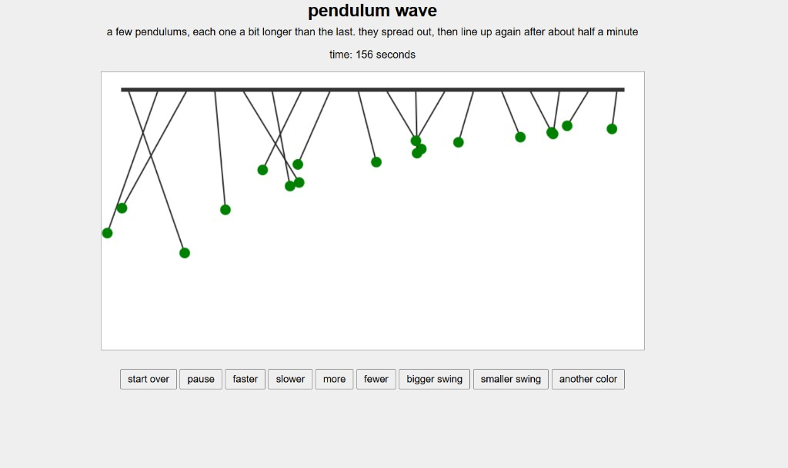

## what is it?

A pendulum wave in the browser. The pendulums hang next to each other, and each one is a bit longer than the last, so they spread out and line up again after about half a minute.

## what's inside

One file, index.html. It draws the pendulums on a canvas. The buttons pause the wave, change the speed, add or remove pendulums, change how wide they swing, and change the ball color.

## controls

start over: puts the pendulums back at the beginning
pause / play: stops the wave and starts it again
faster / slower: changes the speed
more / fewer: adds or removes pendulums
bigger swing / smaller swing: changes how far they move
another color: switches the ball color between red, blue, black, and green

## how to run

Open index.html in a browser(Nothing to install).

## screenshot

## demo

https://yonatamnyuval1-stack.github.io/dynamic_sim/

## Author

Jonathan Jacob

## license

MIT